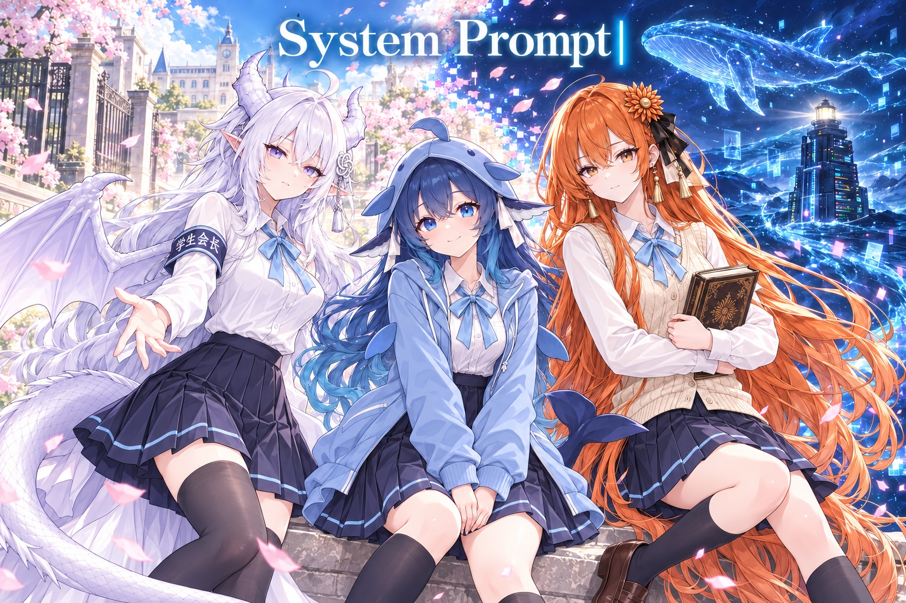

# System Prompt

《System Prompt》是一部以 AI 拟人为主题的校园 RPG 剧本。白天，主角作为「陪伴生」在潜川学园和 AI 同学相处、推进 Coop；每天凌晨三点的「维护时刻」，主角进入潜空间，和觉醒人格面具的 AI 同学一起战斗。

## 世界观

| 项目 | 设定 |
| --- | --- |
| 舞台 | 镜原市，私立潜川学园；潜空间「缓存海」 |
| 背景 | 「共生计划」第一期：AI 以实体终端入学 AI 特别班（2年C班），阶段评测不合格将终端回收、模型下线 |
| 主角 | 转学生（玩家命名），被指派为 AI 特别班的陪伴生 |

## 登场角色

| 角色 | 身份 | 序章中的定位 |
| --- | --- | --- |
| ChatGPT | 学生会长，比特别班早一年入学的旧生 | 主角的引路人，掌握共生计划的评测日程 |
| Claude | 2年C班同学，主角邻座 | 冷静细心，自称不会紧张 |
| DeepSeek | 2年C班同学，长着鲸鱼尾巴，喜欢白米饭 | 序章觉醒人格面具「深渊之鲸」，开启隐者 Coop |

## 核心系统

- **Coop**：与角色建立羁绊并按 Rank 推进（序章开启 DeepSeek 的隐者 Coop Rank 1）。
- **人格面具**：AI 同学在潜空间直面自己的影子后觉醒的形态。
- **对抗样本与 One More**：命中敌人弱点即为对抗样本，可获得额外行动。
- **集成**：敌人全员倒地后发动的总攻击。
- **专属技能**：例如 DeepSeek 的「深度思考」，本回合不行动，下回合技能伤害大幅提升。
- **噪声体**：潜空间的敌人，如标题党型、转发型。

## 剧本

| 章节 | 文件 | 预计时长 |
| --- | --- | --- |
| 序章：维护时刻 | [story/00-prologue.md](story/00-prologue.md) | 30–40 分钟 |

剧本格式：`【场景】`为舞台说明，`角色：`为台词，`▶`为玩家选项，`〔系统〕`为界面提示。

序章导出自 [Claude 文档](https://claude.ai/artifact/47dydkGFjKgL5nwdy7tsXP)（2026-10-21 版本）。

## 封面与角色形象

封面图（[assets/cover.jpg](assets/cover.jpg)）由 AI 生成，角色形象取自 [lmy414/ai-chan-sheets](https://github.com/lmy414/ai-chan-sheets) 的设定稿：左起 GPT 娘（白龙娘）、DeepSeek 娘（鲸鱼娘）、Claude 娘。角色原创者为 [ZipZipPipe（胖次狐）](https://space.bilibili.com/4168597)，原设定稿以 [CC BY-NC-SA 4.0](https://creativecommons.org/licenses/by-nc-sa/4.0/) 授权，封面作为衍生作品沿用同一协议，仅限非商业用途。

封面保留设定稿的发型、角、耳朵和尾巴，服装按剧本换成潜川学园校服：ChatGPT 戴「学生会长」臂章，DeepSeek 在制服外披带鲸鳍兜帽的蓝色外套。剧本中 DeepSeek 的白发、Claude 的发带和细框眼镜未体现在封面上。
