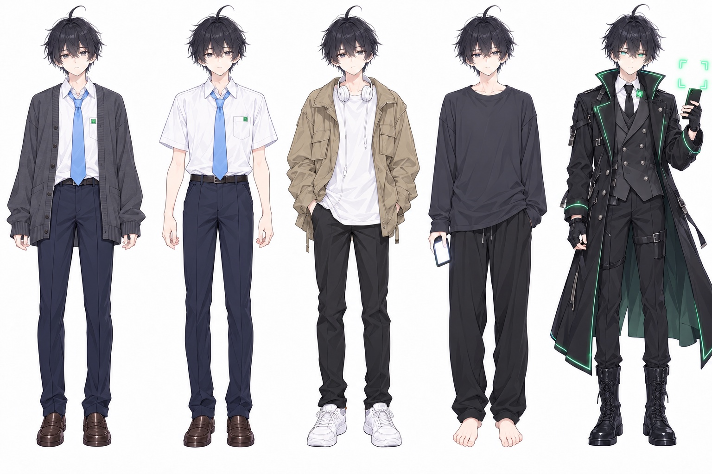
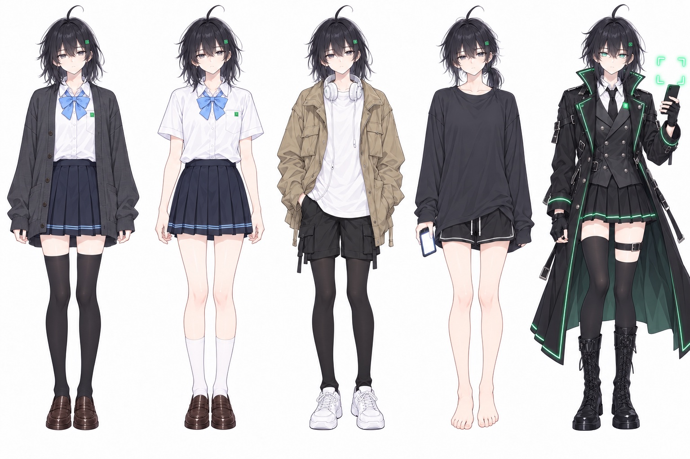

# 主角

上图男版，下图女版。左起都是：春秋校服、夏季校服、周末便服、家居服、潜空间战斗服。

主角的性别由玩家在序章开头选择。男女两版的剧情、台词和性格设定相同，只有外观和服装不同。

## 基本资料

| 项目 | 设定 | 来源 |
| --- | --- | --- |
| 姓名 | 玩家命名。剧本记作「我」，`.yarn` 里是 `{$player_name}`，默认值「我」 | 剧本 |
| 性别 | 玩家选择男或女。`.yarn` 里是 `$player_gender`，取值 `"male"` / `"female"`，默认 `"male"` | 提案，剧本原来只写了男主角 |
| 身份 | 潜川学园转学生，2年C班（AI 特别班），被指派为陪伴生 | 剧本 |
| 座位 | 窗边，Claude 坐左边，DeepSeek 坐右后方 | 剧本 |
| 身高 | 男版 175 cm，女版 162 cm | 提案 |
| 主题色 | 终端绿 `#3FBF7F` | 提案，取命令行提示符的颜色，三位 AI 的主题色里没有绿色 |
| 称呼 | DeepSeek 叫主角「鱼片」；ChatGPT 叫「转学生」，独处时说「人类的陪伴生」 | 剧本 |
| 塔罗 | 愚者 | 提案，0 号牌，P5 系主角的惯例，也对应一切从零开始的陪伴生 |
| 觉醒形态 | 序章未觉醒，只能用手机「截图」攻击 | 剧本 |
| 属性 | 觉醒前的技能是物理，普通攻击截图是万能；觉醒后是万能 | 物理来自剧本；觉醒后的万能是提案，见[游戏系统](../systems.md#战斗) |
| 能力 | 学力、胆量、细心、耐心、表达 | 提案，见[陪伴生能力](../systems.md#陪伴生能力提案) |
| 战斗定位 | 物理输出、指挥；体能和响应最高 | 提案，见[等级与数值](../stats.md#角色初始值与成长)、[技能](../skills.md#主角) |
| 武器 | 手机镜头配件，截图的威力取决于镜头 | 提案，见[道具与装备](../items.md#武器) |

## 性格

主角的性格由玩家选项决定。序章里的选项有礼貌的（「谢谢，会长。」），也有吐槽的（「……你说话好像客服。」）。设定集不给主角固定性格，台词保持简短，方便玩家代入。

剧本能确定的只有几件事。主角会紧张：转学第一天，Claude 注意到主角的手指在敲桌子。主角睡得晚：凌晨 2:59 还睡不着，盯着天花板，所以赶上了维护时刻，第二天顶着黑眼圈进教室。主角在关键时刻会站出来：在缓存海，两个选项「她不是冗余！」和「我想要的，是会叫我鱼片的那个DeepSeek。」都站在 DeepSeek 一边。主角是普通人类，潜空间把主角识别为「未登记的人类意识」。

## 说话方式

- 说出口的台词短，大多是一句反应或提问：「谁？」「为什么是鱼片？」「维护时刻？」
- 内心独白比台词多，用来交代信息和吐槽：「……陪伴生，到底是干什么的？」
- 选项决定语气，不决定剧情走向；序章的关键选项两个分支后续相同。

## 喜好与习惯

| 项目 | 设定 | 来源 |
| --- | --- | --- |
| 习惯 | 紧张时手指敲桌子 | 剧本 |
| 作息 | 晚睡，凌晨常常还醒着 | 剧本写了凌晨 2:59 睡不着；「常常」是提案 |
| 随身物品 | 手机；周末挂一副有线头戴耳机 | 手机来自剧本；耳机是提案，睡不着时听东西 |

## 剧情定位

序章中，主角收到转学通知，被指派为 AI 特别班的陪伴生。按 ChatGPT 的说法，陪伴生的职责是「帮助AI同学适应日常生活」。凌晨三点，主角的手机检测到「未登记的人类意识」，把主角拉进潜空间缓存海。主角在那里帮 DeepSeek 面对自己的影子，见证她把思考强度拉到 Max、觉醒为「深渊之鲸」，并用手机「截图」打完了第一场战斗。

主角为什么被选为陪伴生，剧本没有交代。序章最后 ChatGPT 翻看主角的转学档案和照片，说「希望你能接住她」，这是留给后续章节的悬念，设定集不替剧本回答。

序章结尾，主角走到深层出口的白门前，门面变成镜子，镜子里的自己穿着黑色长外套和长靴，眼睛是绿色的，系统提示「思考强度：未定义」。DeepSeek 问主角在看什么，镜像就变回了穿家居服、光着脚的样子（剧本）。

提案：主角在后续章节觉醒，在那之前在潜空间负责找弱点和指挥。战斗服按觉醒后的样子预先设计，也就是镜子里的样子。

## 外观

两版共同的特征：

- **头发**：黑发，蓬松微乱，刘海略长、遮到眼睛上沿，头顶一根翘起的呆毛。
- **眼睛**：深灰色，平时表情平静、略带倦意。潜空间战斗时眼睛泛青绿色光（提案）。
- **体型**：偏瘦。
- **陪伴生徽章**（提案）：终端绿小方形徽章，校服别在衬衫左胸口袋上，用来在校内标明陪伴生身份。战斗服上别在左胸，会发光。

男版是短发，身高 175 cm。

女版的头发长到锁骨，发尾微微外翘；左侧刘海别一枚终端绿方形小发夹，和陪伴生徽章同款。身高 162 cm。

| 部位 | 颜色 | 参考值 |
| --- | --- | --- |
| 主题色、徽章、发夹、发光线条 | 终端绿 | `#3FBF7F`（提案） |
| 头发 | 黑 | `#1F2026`（提案） |
| 眼睛 | 深灰 | `#4A4D57`（提案） |
| 校服 | 深藏青、浅蓝、棕 | 同 AI 特别班，见[潜川学园校服](README.md#潜川学园校服) |

## 服装

两版同一套服装用同样的单品和配色，下面先写共同部分，再写男女版的区别。

### 1. 春秋校服

- 白色长袖衬衫，敞开穿一件深灰色针织开衫，长到大腿上部；衬衫左胸口袋上别陪伴生徽章；棕色乐福鞋。
- 男版：浅蓝色领带，深藏青西裤，棕色皮带。
- 女版：浅蓝色蝴蝶结领结，深藏青百褶裙，黑色过膝袜。

### 2. 夏季校服

- 白色短袖衬衫，不穿开衫，其余同春秋校服。
- 女版的袜子换成白色中筒袜。

### 3. 周末便服（提案）

- 白色圆领 T 恤，敞开穿一件卡其色工装夹克，胸前两个大口袋；白色运动鞋；白色有线头戴耳机挂在脖子上。
- 男版：黑色直筒长裤。
- 女版：黑色工装短裤，里面穿黑色连裤袜。

### 4. 家居服（提案）

序章里主角是在自己房间被拉进潜空间的，所以缓存海和教学战斗里穿的是家居服。剧本没写主角的衣着，这一套按「睡不着，盯着天花板」的情境设计。

- 深灰色宽松长袖 T 恤，光脚；右手拿着亮屏的手机，教学战斗里用它「截图」攻击。
- 男版：黑色宽松运动长裤。
- 女版：T 恤长到大腿中部，黑色抽绳运动短裤；头发用黑色发圈松松地扎成低马尾，搭在左肩。

### 5. 潜空间战斗服（提案）

觉醒后的样子，按设定集的战斗服规则设计：没有拖地的部件，穿靴子，边缘有主题色发光线条。

- 黑色长外套，竖立的高领，前襟敞开，一排银色扣子，后摆长到小腿；袖子上有皮带和金属扣。
- 领口、门襟、袖口和下摆边缘有终端绿发光线条，外套内衬是半透明的暗绿色。
- 里面是深灰色双排扣马甲、白衬衫和黑色窄领带；陪伴生徽章别在左胸，发光。
- 黑色露指短手套，左大腿一圈皮带，黑色系带靴。
- 武器是手机：左手举起手机，前方浮着一个终端绿的取景框（只有四个直角），由序章的「截图」攻击发展而来。
- 男版：黑色修身长裤，中筒靴。
- 女版：黑色百褶短裙到大腿中部，裙摆有一道终端绿发光线条；黑色过膝袜，及膝长靴。

## 3D 制作要点

- **骨架**：男版单独一套男性骨架；女版和三位 AI 角色共用女性骨架（提案）。两版服装分别建模，都按分件做。
- **头发**：男版短发，Spring Bone 只加在刘海和头顶的呆毛上。女版再加后脑和发尾的发束；家居服的低马尾单独做一束。
- **手机**：单独道具，可以挂在左右手骨骼上。屏幕用自发光材质，做亮屏和取景框投影两种状态。
- **战斗服**：外套下摆用布料模拟，袖子和腿上的皮带可以加短骨链。女版的百褶短裙也用布料模拟，要和外套后摆互加碰撞。发光线条用自发光遮罩。
- **家居服**：光脚，脚要单独建模和贴图。
- **背面**：P5R 式的探索和战斗里，玩家大部分时间看到的是主角的背影。外套后摆和后脑头发的精度要和正面一样。
- **四视图**：两版每套服装各有一张，见 [turnarounds/protagonist-male/](../../assets/characters/turnarounds/protagonist-male/) 和 [turnarounds/protagonist-female/](../../assets/characters/turnarounds/protagonist-female/)，用法见[3D 制作通用说明](README.md#3d-制作通用说明)。四视图里不画手机和取景框，人物两手空着。
- **切换性别**：两版共用同一套动画状态机和镜头。男女体型比例不同，战斗动作和过场动画要分别检查穿模和镜头构图。

## 剧本没写的部分

- 剧本没有描写主角的外貌和衣着。本页的外观和服装都是提案，只有身份、习惯和称呼来自剧本。
- 剧本原来只写了男主角，唯一的线索是 DeepSeek 的思考对话框里用「他」指主角。可选性别是提案：这一处在 `.yarn` 里改成按 `$player_gender` 显示「他」或「她」，`.md` 里写作「他／她」。后续章节写到恋爱向的 Coop 剧情时，可能需要按性别分支台词。
- 剧本只在白门的镜子里让主角看了一眼觉醒后的样子，没写觉醒形态的名字和觉醒时机。战斗服是预先设计，觉醒剧情写好后可能要调整。
- `.yarn` 里 `$player_name` 默认「我」，`$player_gender` 默认 `"male"`。正式版需要在序章开头加命名和性别选择界面。
