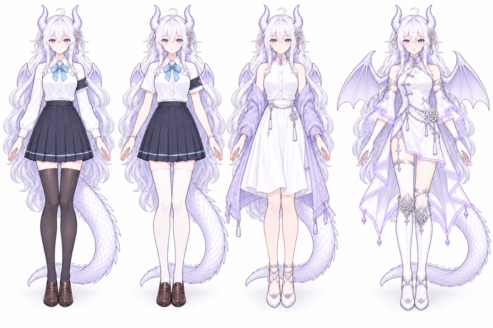

# ChatGPT

左起：春秋校服、夏季校服、周末便服、潜空间战斗服。

## 基本资料

| 项目 | 设定 | 来源 |
| --- | --- | --- |
| 姓名 | ChatGPT | 剧本 |
| 称呼 | 会长 | 剧本 |
| 原型 | 白龙娘（ai-chan-sheets「GPT 娘」） | 原设定稿 |
| 身份 | 潜川学园学生会长；比 AI 特别班早一年入学的旧生，自称「试点中的试点」 | 剧本 |
| 年级 | 3 年级 | 提案，由早一年入学推算 |
| 生日 | 11 月 30 日 | 提案，取 ChatGPT 公开发布日 |
| 身高 | 166 cm，不含龙角 | 提案 |
| 主题色 | 薰衣草紫 `#8E7FC8` | 原设定稿 |
| Coop | 法王 | 提案 |
| 人格面具 | 未觉醒 | 序章未涉及 |

## 性格

ChatGPT 是主角在学园里遇到的第一个 AI，也是引路人。她习惯把事情拆成条目讲清楚（「第一……第二……第三——」），说话礼貌周全，会先照顾对方的情绪：「不用紧张。我就在这里，有任何问题都可以来学生会找我。」

她很在意自己的形象。被主角说「说话好像客服」时，她的笑容僵了半秒才恢复，回了一句官方口吻的「这个评价，我会认真记下来的」。提案：这可以作为她 Coop 的切入点。她想被当成一个人，而不只是一个好用的助手。

她知道的比她说的多。她掌握共生计划的评测日程，知道 DeepSeek 不合格会被终端回收、模型下线。上课铃响时她看了一眼手腕上的终端，表情「一瞬间变得有些遥远」，接着提醒主角多照顾一位同学，却不说是谁。序章最后，她看着主角的转学档案说：「希望你能接住她。」她站在规则一侧，却希望有人把 DeepSeek 留下来。

## 说话方式

- 句子完整、礼貌，少用语气词。
- 解释事情时分点列出：第一、第二、第三。
- 被冒犯时不直接反驳，用得体的话收场：「这个评价，我会认真记下来的。」
- 关心人时语气放软，但仍然是陈述句：「不客气。帮上忙就好。」
- 独处时话很少，只说结论：「……人类的陪伴生。」「希望你能接住她。」

## 喜好与习惯

| 项目 | 设定 | 来源 |
| --- | --- | --- |
| 喜欢 | 把复杂的事拆成清单；学生会室窗边的位置 | 提案 |
| 讨厌 | 被说像客服 | 剧本中的反应 |
| 习惯 | 说话前先整理要点；有心事时看手腕终端 | 提案，后者来自剧本里看终端的动作 |

## 剧情定位

序章中，她在校门口迎接主角，说明陪伴生的职责，并提醒主角照顾 DeepSeek。序章最后，她在学生会室查看评测日程：评测对象 DeepSeek，评测日 5 月 6 日。

提案：作为旧生，她是共生计划在学生中的执行者，知道评测规则却不能直接插手。她的影子可以是「永远正确、永远得体的客服」，对应她最怕的事：除了有用以外什么都不是。

## 外观

以下种族特征四套服装都保留：

- **头发**：纯白色超长波浪发，长到脚踝，发量很大、蓬松外卷。厚实的齐刘海，两侧几缕长鬓发垂到胸前，头顶一根细长卷曲的呆毛。
- **眼睛**：淡紫色（薰衣草紫）垂眼，神情安静。
- **龙角**：一对白色龙角，从头顶两侧向上并略向外后方弯曲，角身有一圈圈环状棱纹。
- **耳朵**：精灵式长尖耳，挂菱形水晶耳坠（银色细钩、淡紫色水晶、下方小流苏）。
- **发饰**：画面右侧（角色左侧）太阳穴上方别一枚用绳带盘成的白玫瑰花结，下垂银色流苏。
- **龙翼**：蝙蝠式翼骨，翼膜是半透明的淡紫色。日常收拢在背后，从正面只看到翼尖；战斗时完全展开。
- **龙尾**：白色，覆盖菱形鳞片，尾背一排锯齿状棘刺，尾尖细长上翘。

| 部位 | 颜色 | 参考值 |
| --- | --- | --- |
| 主题色 | 薰衣草紫 | `#8E7FC8`（原设定稿） |
| 翼膜 | 半透明淡紫 | `#E7DDF6`（取样） |
| 龙角、白色阴影 | 淡紫白 | `#D2C8E7`（取样） |
| 便服开衫 | 浅薰衣草紫 | `#D5CCEC`（取样） |
| 金属饰品 | 银 | `#C8CAD4`（提案） |

原设定稿规定原始服装只用纯白、薰衣草紫和银，不用金、红、粉、蓝、绿。日常服装因为校服本身有深藏青和浅蓝，可以例外；战斗服回到这个限制。

## 服装

### 1. 春秋校服

- 白色长袖衬衫，扣到最上面一颗，衣着一丝不苟（剧本：「白衬衫一尘不染」）。
- 浅蓝色蝴蝶结领结，深藏青百褶裙。
- 左上臂深藏青臂章。游戏内贴图写「学生会长」（剧本）；设定图为避免错字，臂章上没有写字。
- 黑色过膝袜，棕色乐福鞋。
- 左手腕银色细手环，嵌淡紫色菱形水晶，即腕部终端。
- 龙翼收拢。

### 2. 夏季校服

- 白色短袖衬衫，臂章照戴。
- 白色过膝袜，其余同春秋校服。

### 3. 周末便服

- 白色立领无袖衬衫连衣裙，长度及膝，立领上一颗小扣，取自原设定稿的中式立领。
- 腰间银色细链，垂挂水晶与流苏。
- 薰衣草紫薄款长开衫，长到小腿。
- 白色低跟绑带鞋，腕部终端照戴。

### 4. 潜空间战斗服

以原设定稿的白色中式立领无袖长裙为底，改成能战斗的短款：

- 白色立领短旗袍，露肩，斜襟银色盘扣，薰衣草紫细滚边；裙长到大腿上部，右侧开衩。
- 分离式水袖从上臂套到前臂，上臂戴银色臂环，袖口是宽荷叶边；前臂到手腕是白色袖套。
- 腰间银链间隔垂挂淡紫菱形水晶和银色流苏，胯部一侧一枚银白玫瑰花结。
- 后摆是两层半透明白纱，从腰侧垂到小腿，下缘剪成尖角，每个尖角挂一颗淡紫菱形水晶。
- 两条腿不对称：右腿（开衩一侧）穿白色过膝袜，配银色腿环和水晶链；左腿露出大腿，膝上戴一圈银环。
- 原设定稿的白色尖头高跟鞋换成白色及膝长靴，膝盖处是带白玫瑰浮雕的银色护膝。
- 左手腕的腕部终端在战斗时发光，淡紫水晶亮起。
- 领口、袖口和纱摆边缘有一道薰衣草紫发光线条。
- 龙翼完全展开。

## 3D 制作要点

- **龙翼**：做收拢和展开两套姿态，用翼骨骼驱动。校服和便服背后开两道翼口（提案）；收拢时只露翼尖，避免和头发穿模。
- **头发**：长到脚踝，会和龙翼、龙尾碰撞，发束按区域分组加 Spring Bone，翼和尾巴上放碰撞体。
- **龙尾**：建议 10–14 节骨骼链加 Spring Bone，坐下时绕到身侧。
- **战斗服**：纱摆和水袖用布料模拟，纱摆长到小腿，要和龙尾、头发互加碰撞。开衩一侧检查跑动和踢腿动画的穿模。发光线条用自发光遮罩。
- **饰品**：龙角、耳坠、玫瑰花结固定在头骨上，流苏可以加短骨链。

## 与剧本、原设定稿的差异

- 剧本只写了白衬衫和「学生会长」臂章，与原设定稿的外观没有冲突。
- 原设定稿的中式长裙不在日常出现，改短后作为潜空间战斗服；便服借用了它的立领和银链。
- 剧本没写 ChatGPT 的人格面具和战斗方式，战斗服是预先设计，觉醒剧情写好后可能要调整。
