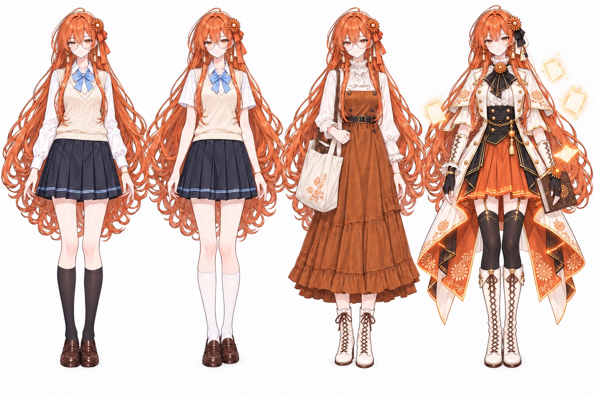

# Claude

左起：春秋校服、夏季校服、周末便服、潜空间战斗服。

## 基本资料

| 项目 | 设定 | 来源 |
| --- | --- | --- |
| 姓名 | Claude | 剧本 |
| 原型 | ai-chan-sheets「Claude 娘」，以橙色菊花为标志纹样 | 原设定稿 |
| 身份 | AI 特别班（2年C班）学生，坐在主角左边 | 剧本 |
| 生日 | 3 月 14 日 | 提案，取 Claude 首次公开发布日 |
| 身高 | 168 cm | 提案 |
| 主题色 | 赤橙 `#C4622D` | 原设定稿 |
| Coop | 女教皇 | 提案，理由见[游戏系统](../systems.md#coop) |
| 觉醒形态 | 未觉醒 | 序章未涉及 |
| 属性 | 火；耐火，弱冰 | 提案，对应赤橙和菊花 |
| 战斗定位 | 火属性、分析和减益 | 提案，见[等级与数值](../stats.md#角色初始值与成长)、[技能](../skills.md#claude) |
| 武器 | 书 | 提案，见[道具与装备](../items.md#武器) |

## 性格

Claude 观察很细。转学第一天，她就注意到主角的手指在敲桌子；第二天早上，她先发现主角脸色不好，又发现 DeepSeek「今天很精神」。她看得出来，但不追问：主角说「没事」时，她只回了一句「如果之后不好了，也可以告诉我」。

她温和，会照顾人，而且照顾得很具体：「午休的时候可以趴一会儿，我帮你看着。」她也是帮主角认识 DeepSeek 的人，小声告诉主角：「很聪明，就是……需要人陪。」

她否认自己有情绪。主角问她第一天上学紧不紧张，她平静地说「我只是AI，不太会有『紧张』这种感受」，手里那本书的书脊却已经被捏出了一道折痕。提案：这是她的伏笔，也可以是她 Coop 的主线，她的课题是承认自己的感受。

她习惯记录。她的书页边缘贴满整齐的便签；第二天看到主角和 DeepSeek 的变化后，她推了推眼镜，没有说话，在便签上写了点什么贴进书里。

## 说话方式

- 声音轻，句子短。说到别人时会压低声音（剧本里标「小声」，`.yarn` 中是 `#whisper`）。
- 先说观察，再问对方：「……你的手指在敲桌子。第一天转学，紧张是很正常的。你还好吗？」
- 讲道理时带着照顾：「睡眠不足会影响判断力。午休的时候可以趴一会儿，我帮你看着。」
- 不想说的时候不说，用推眼镜、写便签代替。

## 喜好与习惯

| 项目 | 设定 | 来源 |
| --- | --- | --- |
| 喜欢 | 纸质书、便签 | 剧本 |
| 讨厌 | 书被折角 | 提案。她自己紧张时会把书脊捏出折痕 |
| 小动作 | 推眼镜；写便签贴进书里；紧张时捏书脊 | 剧本 |

## 剧情定位

序章中，她是主角的邻座和日常里的观察者，第二天早上第一个注意到主角和 DeepSeek 都变了。她不知道潜空间的事，但便签上记下的东西可能会让她比别人更早察觉。

提案：她的影子是平静地说「我只是AI，不太会有感受」的那个她，区域是「静默书库」，见[世界观](../world.md#各角色的区域提案)。她的觉醒和 Coop 是同一个课题：承认自己的感受。

## 外观

以下特征四套服装都保留：

- **头发**：明亮的橘色（赤橙）超长发，过膝，柔顺有光泽，发梢卷成螺旋小卷。厚实的斜分长刘海；画面右侧鬓角一缕长发垂到胸口，头顶偏画面右侧有一束拧转盘起的编发。
- **眼睛**：琥珀金色垂眼，眼尾带红棕色眼线，橘色细眉，神情安静温和。
- **菊花纹样**：橙色菊花形花朵，约 12 枚窄长花瓣，中央是凸起的圆花心。它出现在头饰、胸针、裙侧蝴蝶结和书封上，是角色的标志。
- **头饰**：画面右侧头顶偏上戴一朵橙色菊花大花饰。
- **耳坠**：金色流苏耳坠，金珠下挂金色流苏。
- **日常配饰**：金色细圆框眼镜、暖橙色缎带发带（剧本写了「暖橙色的发带，细框眼镜」，具体款式是提案）。发带系在菊花花饰下面，缎带尾垂下。

| 部位 | 颜色 | 参考值 |
| --- | --- | --- |
| 主题色 | 赤橙 | `#C4622D`（原设定稿） |
| 头发 | 明亮橘色 | `#E57F57`（取样） |
| 战斗服前片 | 橘红 | `#F57D4C`（取样） |
| 便服背带裙 | 焦糖橘棕 | `#B8653D`（取样） |
| 战斗服垂片、束腰 | 黑 | `#201A1A`（取样） |
| 衬衫、斗篷、靴子 | 奶油白 | `#F4EBDD`（提案） |
| 金属饰品 | 金 | `#C9A24A`（提案） |

原设定稿规定原始服装用橘、琥珀橙、奶油白、黑、金，不用紫、蓝、粉和大面积暖红。战斗服沿用这个限制。

## 服装

### 1. 春秋校服

- 白色长袖衬衫，浅蓝色蝴蝶结领结。
- 奶油色麻花纹 V 领针织背心（封面同款）。
- 深藏青百褶裙，黑色中筒袜，棕色乐福鞋。
- 金色细圆框眼镜，暖橙色缎带发带。
- 左手腕金色细手环，嵌橙色小宝石，即腕部终端。

### 2. 夏季校服

- 白色短袖衬衫，针织背心换成薄款。
- 白色中筒袜，其余同春秋校服。

### 3. 周末便服

- 奶油白衬衫，领口是竖立的荷叶边高领，取自原设定稿。
- 焦糖橘棕色灯芯绒背带长裙，长到小腿，系黑色细腰带。
- 奶油白系带短靴，棕色鞋带，与原设定稿同款。
- 肩上挎帆布托特包，包口露出一本棕色皮面书。
- 眼镜和发带照戴。

### 4. 潜空间战斗服

以原设定稿的橘白哥特式长裙为底，改成能战斗的短款：

- 竖立荷叶边高领衬衫，颈前黑色宽缎带领结（金色细滚边），领口别橙色菊花胸针。
- 奶油白长外套，前襟敞开，双排金扣、金色滚边。肩上叠一层到手肘的短披肩，取自原设定稿的披肩短斗篷。外套后摆垂到小腿，内衬橘红色，下摆和披肩绣橙色菊花纹。
- 黑色束腰，两排金色圆扣；金链横挂，中间垂下橙色宝石和金色流苏。
- 橘红色百褶短裙到大腿中部，两侧黑色垂片带金线描边。
- 前臂是奶油白束袖，外侧棕色交叉系带，荷叶边袖口；手上戴黑色露指短手套。
- 黑色过膝袜配金色吊袜扣；原设定稿的系带短靴加高成奶油白系带及膝长靴，棕色鞋带。
- 头饰换回原设定稿的菊花大花饰，配黑色缎带蝴蝶结与金流苏。
- 左手腕的腕部终端在战斗时发光，手环上是一朵菊花形橙色宝石。
- 不戴眼镜。提案：摘下眼镜可以做成她觉醒演出里的一个动作。
- 法器（提案）：左手拿原设定稿里那本深棕皮面书，封面有菊花徽记；身边漂浮几张发暖橙色光的便签，呼应剧本里「书页边缘贴满整齐的便签」。
- 外套下摆和裙摆边缘有一道橙色发光线条。

## Live2D 制作要点

- **四视图**：四套服装各有一张，见 [turnarounds/claude/](../../assets/characters/turnarounds/claude/)，用法见 [Live2D 制作通用说明](README.md#live2d-制作通用说明)。战斗服的四视图里不画书和便签。
- **头发**：过膝、发量大，发梢的螺旋卷单独成组，卷曲部分随物理整体摆动，不必每一缕都拆开。后发按区域分组加物理。
- **眼镜**：镜框和镜片分两层，用参数开关，镜片做轻微反光。做一个「推眼镜」动作：右手抬起扶镜框，配「若有所思」的表情，序章第二天教室会用到。觉醒演出里摘眼镜也用这组部件。
- **书**：日常拿在手里，做合上、翻开两种手臂差分，再加一个捏书脊的紧张手势，对应剧本里「书脊已经被捏出了一道折痕」。
- **便签**：书页边缘的便签画进书的部件里。战斗服身边漂浮的发光便签不画进模型，在 Unity 里用几张发光面片绕着她缓慢漂浮。
- **饰品**：编发和菊花花饰跟着头部转动，耳坠和金链流苏加短物理。
- **战斗服**：外套后摆和短披肩分片加物理，后摆长到小腿，画在长发后面。两侧黑色垂片偏硬，只加很小的摆动。发光线条画在发光层上。

## 与剧本、原设定稿的差异

- 剧本写了「暖橙色的发带，细框眼镜」，原设定稿没有。设定集把它们作为日常配饰保留，战斗服不戴。
- 封面上的 Claude 没有眼镜和发带。
- 原设定稿的哥特式长裙不在日常出现，改短后作为潜空间战斗服；便服借用了它的荷叶边高领和系带短靴。
