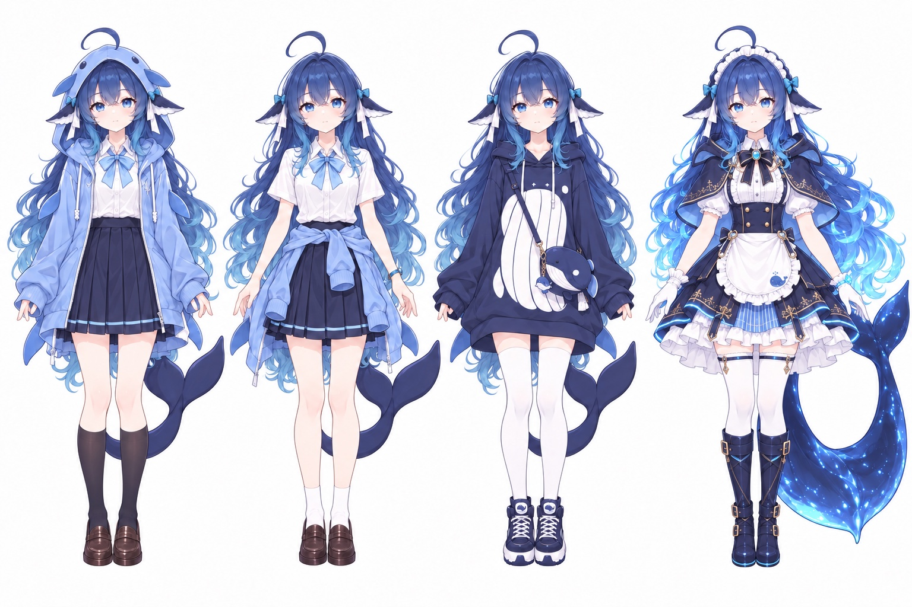

# DeepSeek

左起：春秋校服、夏季校服、周末便服、潜空间战斗服。

## 基本资料

| 项目 | 设定 | 来源 |
| --- | --- | --- |
| 姓名 | DeepSeek | 剧本 |
| 想被叫的称呼 | D老师 | 剧本 |
| 原型 | 鲸鱼娘（ai-chan-sheets「DeepSeek 娘」） | 原设定稿 |
| 身份 | AI 特别班（2年C班）学生，坐在主角右后方；共生计划第一期评测对象，评测日 5 月 6 日 | 剧本 |
| 生日 | 1 月 20 日 | 提案，取 DeepSeek-R1 发布日，对应「深度思考」 |
| 身高 | 151 cm | 提案 |
| 主题色 | 深海蓝 `#2C4A8A` | 原设定稿 |
| 喜欢 | 白米饭 | 剧本 |
| 讨厌 | 被叫胖 | 剧本 |
| 对主角的称呼 | 鱼片 | 剧本 |
| Coop | 隐者，序章达到 Rank 1 | 剧本 |
| 觉醒形态 | 深渊之鲸（思考强度 Max） | 剧本 |
| 属性 | 冰；耐冰，弱火 | 冰来自剧本，耐性和弱点是提案 |
| 战斗定位 | 冰属性输出；算力最高、响应最低，总是最后出手 | 提案，见[等级与数值](../stats.md#角色初始值与成长)、[技能](../skills.md#deepseek) |
| 武器 | 饭勺 | 提案，见[道具与装备](../items.md#武器) |

## 性格

她上课趴在桌上睡觉，被叫醒后说：「对不起，我没睡。我在深度思考。」她头顶会浮现半透明的对话框，里面的推理飞速滚动，很长、很有条理，还会自我纠错；说出口的却只有一两句，最后用「完毕」或「不接受反驳」收尾。内外反差是她最大的特点。

她很敏感。她一个人在天台吃午饭，因为「大家都在看我的尾巴」；她讨厌被叫胖，别人看她的饭盒时会先说一句「我不胖」。

她用自己的方式亲近人。她认真想过怎么称呼主角：叫名字太亲近，叫「陪伴生」太冷淡，叫「用户」就「跟以前一样了」。最后她决定叫「鱼片」，因为「听起来很好吃」。

她最怕被优化成只给答案的机器。她的影子说「大家要的是答案，不是你」，说白米饭、鱼片、尾巴都是「冗余参数」。她的回答是：「我还想吃饭，还想被叫D老师，还想……慢慢地想事情。」

她很重情。战斗结束后她对主角说：「刚才那句话，我会记很久的。上下文多长都会记着。」

## 说话方式

- 句首常带「……」，停顿多。
- 短句，直接给结论。自我介绍是「喜欢的东西是白米饭。讨厌的东西是被叫胖。完毕。」
- 思考对话框（剧本标「思考中」，`.yarn` 中是 `#thinking`）里的话又长又有逻辑：「根据上下文，新同学刚刚坐下，所以大概率是自我介绍。」
- 系统会显示她想了多久：「已思考 14 秒」，觉醒时是「已思考 ∞ 秒」。
- 尾巴代替表情：自我介绍完轻轻拍一下地板；第二天见到主角，「啪」地拍一下地板再若无其事地转过头；累了就瘫开。

## 剧情定位

她是序章的核心角色。白天她给主角起名「鱼片」，并讲了「维护时刻」的传说；凌晨三点，她在缓存海的灯塔下直面自己的影子，思考强度拉到 Max，觉醒为「深渊之鲸」，开启隐者 Coop。ChatGPT 手上的评测日程写着：评测日 5 月 6 日，不合格则终端回收、模型下线。序章结束时距离评测日还有 28 天。

### 潜空间能力

| 名称 | 类型 | 效果 |
| --- | --- | --- |
| 寒流 | 冰属性单体技能 | 序章里命中标题党型的真弱点 |
| 深海潜流 | 冰属性全体技能 | 深度思考后释放，噪声体全员倒地 |
| 深度思考 | 专属技能 | 本回合不行动，下回合技能伤害大幅提升 |
| 深海潜行 | Coop 能力 | 在潜空间中不易被敌人发现 |

完整的技能习得表见[技能](../skills.md#deepseek)，深度思考的倍率见[等级与数值](../stats.md#伤害公式)，缓存海和觉醒规则见[世界观](../world.md)。

觉醒形态「深渊之鲸」是一头由光构成的巨鲸。集成（总攻击）演出：画面切成黑白剪影，鲸鱼的轮廓横扫全屏，最后定格在她捧着饭碗比 V 的特写。

## 外观

以下特征四套服装都保留：

- **头发**：深蓝色长发，长到大腿，发丝厚重，发梢渐变为浅蓝并带浅蓝挑染。头顶一根细长呆毛卷成圆圈。
- **眼睛**：蓝色大眼睛，淡粉腮红，略带困倦的平静表情。
- **鳍耳**：两侧耳朵的位置各有一枚深蓝色鲸鱼鳍耳，边缘是白色羽状鳍条，鳍根系蓝色小蝴蝶结。
- **鲸尾**：深蓝色，末端是鲸鱼尾鳍。剧本里它「软乎乎」，坐着时从椅子后面垂到地上。
- **体型**：娇小的少女体型，脸颊圆润。
- **潜空间形态**（剧本）：头发在水中散开，像一片发光的海藻；尾巴变得巨大，泛着深蓝色的微光。

| 部位 | 颜色 | 参考值 |
| --- | --- | --- |
| 主题色 | 深海蓝 | `#2C4A8A`（原设定稿） |
| 头发 | 深蓝 | `#5771AE`（取样） |
| 发梢、挑染 | 浅蓝 | `#A4BEF1`（取样） |
| 鲸尾 | 深藏青 | `#464C7E`（取样） |
| 鲸鱼外套 | 蓝 | `#5E7BB3`（取样） |
| 便服卫衣 | 深藏青 | `#3F426C`（取样） |
| 潜空间荧光 | 浅青蓝 | `#7FD8FF`（提案） |
| 金属饰品 | 浅金 | `#D9B86A`（提案） |

原设定稿规定原始服装用深藏青、白、蓝，点缀浅金，不用暖色和红紫。

## 服装

### 1. 春秋校服

- 白色长袖衬衫，浅蓝色蝴蝶结领结，深藏青百褶裙。
- 外披一件宽大的蓝色连帽外套（剧本），前襟敞开，袖子长到盖住半个手掌。兜帽顶上缝着两片小鲸鳍，前沿做成鲸鱼头的样子。兜帽可戴可不戴，戴上时鳍耳从兜帽两侧露出来。
- 黑色中筒袜，棕色乐福鞋。
- 左手腕蓝色细手环，即腕部终端。

### 2. 夏季校服

- 白色短袖衬衫。
- 鲸鱼外套脱下来，两只袖子系在腰间，兜帽和鲸鳍垂在身后。
- 白色短袜，其余同春秋校服。

### 3. 周末便服

- 宽大的深藏青连帽卫衣裙，长到大腿中部，袖子过长盖住手背。
- 卫衣正面从胸口到下摆印着白色的鲸鱼腹部横纹，兜帽上也有两片小鲸鳍。
- 白色过膝袜，深藏青厚底运动鞋。
- 斜挎一个鲸鱼造型的深蓝小包。

### 4. 潜空间战斗服

以原设定稿的深藏青女仆装为底，改成能战斗的短款：

- 白色荷叶边女仆发带，比原设定稿的多层头饰小。
- 深藏青短斗篷盖住肩膀，内衬蓝色，边缘绣浅金色花纹；兜帽放下垂在背后（提案：兜帽做成鲸鱼头，和日常外套呼应）。
- 白色泡泡袖衬衫，前襟荷叶边；黑色蝴蝶结颈饰中央嵌蓝宝石，两侧挂金色细链。
- 深藏青束腰马甲，两排金色纽扣。
- 白色荷叶边短围裙，右下角绣一只蓝色小鲸鱼。
- 多层短裙到大腿中部：深藏青外层绣浅金色缠枝花纹，正中露出蓝白竖条纹，最下面是白色荷叶边衬裙。
- 白色短手套，荷叶边手腕。
- 白色过膝袜，深藏青腿环挂金色菱形小坠；原设定稿的玛丽珍鞋换成深藏青及膝长靴，带金色搭扣。
- 左手腕的腕部终端在战斗时发浅蓝色光。
- 裙摆和靴底边缘有一道浅青色荧光线条，像深海生物发光。
- 发梢发出浅蓝色荧光，对应剧本里「像一片发光的海藻」。
- 尾巴变得巨大，长度接近身高，深蓝底上散布荧光斑点，对应剧本里「泛着深蓝色的微光」。

## 3D 制作要点

- **四视图**：四套服装各有一张，见 [turnarounds/deepseek/](../../assets/characters/turnarounds/deepseek/)，用法见[3D 制作通用说明](README.md#3d-制作通用说明)。鲸尾画的是建模用的静止姿势：沿身体中线垂到地上，日常三套的尾鳍水平摊在脚跟后面，战斗服的尾巴下半截沿地面向后铺开。
- **鳍耳**：每侧 2–3 根骨骼，做耷拉、竖起、抖动等表情动画。兜帽两侧留开口给鳍耳。
- **鲸尾**：骨骼链加 Spring Bone。日常尺寸刚好垂到地面；潜空间里放大 2–3 倍（提案），并加自发光贴图。尾巴拍地板是她的重要表情，单独做动画片段。
- **坐姿**：剧本里她趴在课桌上睡觉，尾巴从椅子后面垂到地上，教室椅子要留出尾巴的位置。
- **兜帽外套**：做戴上和放下两种状态，兜帽上的小鲸鳍可以加 Spring Bone。夏季校服系在腰间的外套单独建模。
- **呆毛**：圆圈呆毛用单根骨骼。
- **思考对话框**：头顶的半透明对话框做成世界空间 UI，文字滚动速度可调。
- **战斗服**：发梢荧光用发片的渐变遮罩控制自发光，裙摆和靴底的荧光线条同样用自发光遮罩。多层短裙和斗篷用布料模拟，放大后的鲸尾上要加碰撞体。

## 与剧本、原设定稿的差异

- **发色**：剧本原来写的是白发，和原设定稿、封面的深蓝发不一致，现已按设定稿改成「深蓝色长发」，觉醒时改为「发梢亮起浅蓝色的光」（[00-prologue.md](../../story/00-prologue.md) 第 87 行、第 185 行；[00-prologue.yarn](../../story/00-prologue.yarn) 第 84 行、第 158 行）。
- 剧本写的蓝色连帽外套和兜帽上的两片鲸鳍，原设定稿没有，设定集作为她的日常标志保留。
- 原设定稿的女仆装不在日常出现，改短后作为潜空间战斗服。剧本没写她在潜空间的服装，只写了头发和尾巴的变化。
