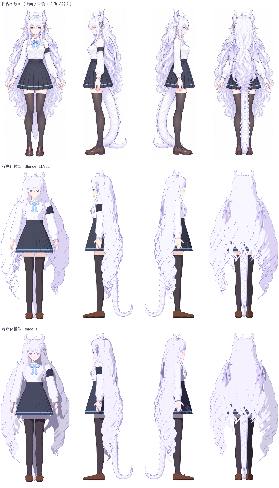
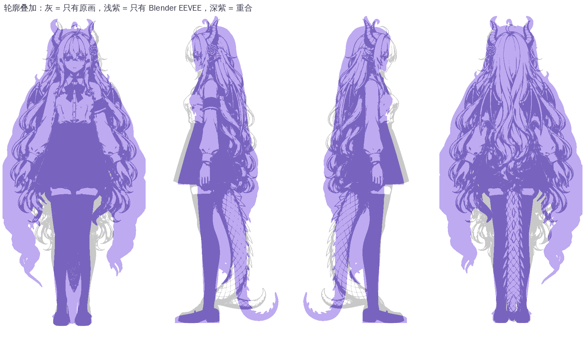
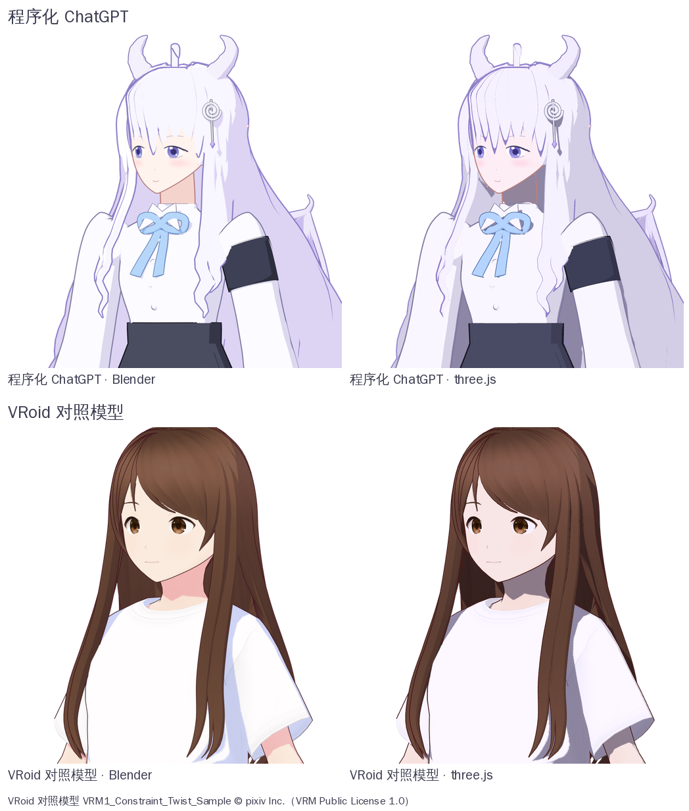
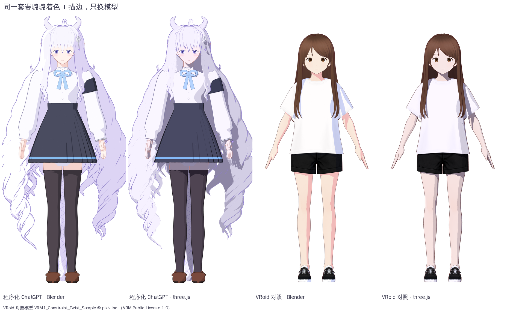

# 三渲二 3D 角色可行性试验

用 ChatGPT 的春秋校服（`assets/characters/turnarounds/chatgpt/1-uniform/`）做对象，在没有 GPU 的云端容器里验证两件事：能不能用脚本做出原神、崩铁那类赛璐璐着色加描边的效果；产出的模型能不能接进 Unity 6。这是可行性试验，不是正式美术产出。

## 结论

1. **渲染管线可行。** Blender 和 three.js 两条路线都在 4 核 CPU、无 GPU 的云端真实跑通，产出了赛璐璐三色阶着色、inverted hull 描边、头发法线编辑和 `.glb` 导出。
   - Blender 5.2：PyPI 上的官方 `bpy` 模块，EEVEE 走 Mesa llvmpipe 软件 OpenGL，每个视角约 20 秒。
   - three.js r186：无头 Chromium，SwiftShader 提供 WebGL2，每个视角约 2 秒。
2. **程序化建模只能做到“比例和轮廓对”，成品像橡皮泥捏的。** 轮廓叠加图里，身高、头身比、裙长、袜口、尾巴走向都和四视图对得上。但脸、头发、手和衣褶离二游成品差得很远，继续调参数也补不上。
3. **对照实验说明差距在模型，不在渲染。** 同一套着色、描边和灯光，只把模型换成 pixiv 发布的 VRoid 风格示例角色，两个渲染器都立刻是二游的观感（见[对照实验](#对照实验同一套管线换成专业模型)）。
4. **建议**：
   - 正式角色走“VRoid Studio 或外包建模，加 Blender 补角、翼、尾巴”。
   - 本目录的脚本留作 PV 镜头预演、比例检查和着色管线原型。
   - AI 图生 3D 需要 16 GB 以上显存的 GPU，云端没有，没能实测。
   - Unity 侧用 UTS3（或 VRM 路线用 MToon）。

## 对比图

最上面一行是四视图原画，下面两行是程序化模型分别在 Blender EEVEE 和 three.js 里的渲染。两个渲染器读的是同一个 `.glb`（Blender 渲染的是源场景）。



轮廓叠加（灰 = 只有原画，浅紫 = 只有渲染，深紫 = 重合）：



近景胸像（30° 侧转），上面是程序化 ChatGPT，下面是 VRoid 对照模型：



## 对照实验：同一套管线换成专业模型

程序化模型看起来像橡皮泥捏的。为了分清问题出在建模还是渲染，我把 VRM 官方规范仓库里的示例角色 [VRM1_Constraint_Twist_Sample](https://github.com/vrm-c/vrm-specification/tree/master/samples/VRM1_Constraint_Twist_Sample)（© 2022 pixiv Inc.；骨骼和材质是 VRoid Studio 的命名规则，应是 VRoid 制作）放进完全相同的管线：
- 着色：同一套 Shader to RGB 三色阶 / MeshToonMaterial；
- 描边：同一套 inverted hull；
- 灯光：同一盏主光加环境光。

只做了必要的适配：
- 读取模型自带的 MToon 阴影色；
- 脸部贴花和眼睛不描边；
- 用骨骼把 T-pose 的手臂放下来。



结果：脸的平面切分、发束的尖角和层次、T 恤袖口的厚度，这些“二游感”都来自建模和贴图，着色器只是把它们表现出来。

授权：模型内嵌的 VRM 元数据写明 `avatarPermission: everyone`、`commercialUsage: corporation`、`allowRedistribution: true`、`modification: allowModificationRedistribution`、`creditNotation: unnecessary`，适用 [VRM Public License 1.0](https://vrm.dev/licenses/1.0/)。模型文件不提交到仓库，由 `run_all.sh` 下载到 `out/cache/` 并校验 sha256。

## 产出

| 路径 | 内容 |
| --- | --- |
| `blender/geom.py` | 程序化网格工具：环形截面堆叠、沿路径扫掠、法线编辑 |
| `blender/character.py` | ChatGPT 春秋校服的各个部件，尺寸按四视图量取 |
| `blender/toon.py` | EEVEE 赛璐璐材质（Shader to RGB → Color Ramp）和 inverted hull 描边 |
| `blender/make_textures.py` | 用 Pillow 画脸部贴图和龙尾鳞片贴图 |
| `blender/build.py` | 建模、着色、渲染五个视角，保存 `.blend`，导出 `.glb` |
| `blender/render_reference.py` | 对照实验：导入 VRoid 模型，套同一套材质和描边，摆手臂后渲染 |
| `threejs/scene.js`、`threejs/render.mjs` | three.js 场景，以及用无头 Chromium 截图的脚本 |
| `compose.py` | 拼对比图、轮廓叠加图 |
| `out/chatgpt_uniform.blend` | Blender 源场景，含材质、描边修改器、灯光和正面相机，打开后按 F12 即可复现正面图 |
| `out/chatgpt_uniform.glb` | 导出模型（不含描边壳），材质 extras 里带三色和描边参数 |
| `out/renders/` | 各路线、各视角的 2 倍分辨率原始渲染（透明背景 PNG），由 `run_all.sh` 生成，不提交 |
| `out/*_stats.json` | 面数、渲染耗时、实际使用的 GPU 后端 |

## 从零重跑

```bash
experiments/toon-3d/setup_env.sh   # 一次性：Mesa EGL、Python 3.13 venv 里的 bpy 5.2.3 和 Pillow、npm ci
experiments/toon-3d/run_all.sh     # 贴图 → 建模和 Blender 渲染 → three.js → 对照实验 → 拼图，约 3 分钟
```

- venv 默认放在 `~/.cache/toon3d/venv`，可以用 `TOON3D_VENV` 改位置。
- Chromium 默认用云端镜像自带的 `/opt/pw-browsers/chromium-1194/chrome-linux/chrome`，可以用 `CHROME_PATH` 改。
- 在本机有 Blender 5.2 时也可以直接跑 `blender -b --python blender/build.py -- --out out`。脚本兼容这种调用方式，但云端没装 Blender 二进制，没有实测。

### 云端环境踩到的问题

- **网络策略拦截**：以下域名都返回 403。
  - Blender 官方下载站 `download.blender.org` 和几个镜像站；
  - GitHub Releases；
  - `huggingface.co`、`cdn.jsdelivr.net`。

  所以 Blender 改用 PyPI 的官方 `bpy` 轮子：pypi.org 可达，5.2.3 正好对应容器里的 Python 3.13。apt 里也有 Blender 4.0.2，但版本太旧，没用。
- **LFS 推不上去**：`lfs.github.com` 同样被拦，所以本目录的 `.blend`、`.glb` 和对比图暂时作为普通 Git 文件提交，原因写在 `experiments/toon-3d/.gitattributes` 里。放开该域名后，删掉那个文件再重新 `git add`，就能迁回仓库规定的 LFS。
- **EEVEE 无 GPU**：装上 `libegl1 libegl-mesa0` 后，bpy 通过 EGL 拿到 llvmpipe 的 OpenGL 4.5 上下文，EEVEE 能正常出图。每次启动都会打印三行 `EGL_BAD_MATCH`，不影响渲染。
- **WebGL**：Chromium 加 `--use-angle=swiftshader --enable-unsafe-swiftshader` 后，拿到 SwiftShader 的 WebGL2，支持阴影贴图。

## Blender 路线

**建模。** 所有部件都由两种基本操作拼出来，然后用 `from_pydata` 生成网格。
- 两种操作：
  - 一圈圈水平截面堆叠：头、躯干、腿、百褶裙、鞋；
  - 沿样条扫掠出截面：手臂、发束、角、尾巴、翼骨。
- 尺寸来源：
  - 从四视图量出比例尺是 1.775 mm/像素，鞋底分别在第 989 行（正面）和第 980 行（侧面、背面）；
  - 身高 1.66 m，约 7.2 头身，角尖 1.73 m。
- 面数和用时：全身 15.9 万三角面，其中头发 9.6 万；建模本身 1 秒。
- 相机：正交相机按四视图的比例尺和鞋底位置取景，渲染图和原画逐像素对齐，所以能做轮廓叠加。

**着色。** 每个材质的节点是：白色 Diffuse BSDF → Shader to RGB → Color Ramp（Constant 插值，三个色标）。
- 三个色阶分别是固有色、1 阶阴影、2 阶阴影（遮挡处），阴影色按设定集取色，比如白发的阴影是淡紫。
- 投影会参与色阶判断。
- 脸部单独把阈值压低，基本不进阴影，这是二游脸部的常见做法。
- 头发和皮肤加了一点菲涅尔边缘光。

**法线编辑。** 第一版头发由几十条发束互相投影，明暗非常碎。改进后：
- 把头发的顶点法线朝一个平滑的代理形状（头顶是球、下面是竖直圆柱）偏转 80%；
- 关掉头发的投影。

这样明暗变成了大块色面，这是二游头发的标准做法。法线写成自定义法线，会跟着 `.glb` 导出，three.js 渲染时同样生效。

**描边。** inverted hull：给每个部件加一个 Solidify 修改器，参数是 `thickness>0`、`offset=+1`、翻转法线、不封边，再通过 material offset 切到只渲染背面的纯色描边材质。
- 描边宽度按部件设，头发 2.6 mm，小饰品 1 mm。
- 描边颜色是各材质阴影色的深色版：头发用主题色薰衣草紫，裙子用近黑色。
- 没用 Freestyle，因为 inverted hull 能原样带到 three.js 和 Unity。

**导出 `.glb`。** 导出时有三件事要处理：
- **材质**：每个材质里预留一个不接线的 Principled BSDF，导出时临时接到输出节点，导完再恢复。
- **描边壳**：导出前关闭描边修改器，所以 `.glb` 不含描边壳。
- **extras**：三色、阈值、描边色写在材质 extras 里，描边宽度和是否投影写在物体 extras 里，three.js 和 Unity 可以直接读取。

## three.js 路线

`threejs/scene.js` 用 GLTFLoader 读同一个 `.glb`，把材质换成 MeshToonMaterial：
- 渐变贴图：16 像素宽，Nearest 采样，分三阶；
- 主光：一盏带阴影贴图的方向光，方向和 Blender 的太阳一致；
- 环境光：淡紫色，充当阴影染色。

正交相机的取景和 Blender 完全相同，用 playwright-core 驱动无头 Chromium 截图。

两个发现：

- **OutlineEffect 不适合薄发片。** 最初用 three.js 自带的 OutlineEffect。它在屏幕空间沿投影后的法线外扩，盖在额头上的薄刘海之间的缝隙会被描边壳整块糊成紫色。后来改成和 Blender 一样的物体空间 inverted hull：复制网格，用只渲染背面的 MeshBasicMaterial，在蒙皮前沿法线外扩，所以对蒙皮模型同样有效。改完以后两边的描边基本一致。
- **MeshToonMaterial 不能按材质指定阴影色。** 它的暗部只能是“固有色 × 光照”，阴影色由环境光统一染色，做不到 Blender 里白发配淡紫阴影、皮肤配粉色阴影那样逐材质设定。要做到 UTS 那种 1 阶、2 阶阴影色，需要自写 ShaderMaterial，或者用 `onBeforeCompile` 改片元着色器。所以 three.js 版的颜色比 Blender 版略灰。

## 离二游成品还差什么

| 方面 | 本次程序化模型 | 二游成品需要 |
| --- | --- | --- |
| 面部 | 椭球加一张平面投影的眼睛贴图，侧面会拉伸；鼻子只是一个小凸起 | 专门建模的脸型，眼睛、嘴分层建模或贴花；面部用 SDF 阴影图或法线编辑控制阴影形状；侧脸要单独修形 |
| 头发 | 管状发束加程序化波浪，靠法线编辑把明暗整理成块 | 手工设计的发束形状：尖角、分层、发梢走向；高光（天使环）和刘海在额头上的投影用遮罩控制；每组发束配 Spring Bone |
| 表情 | 没有 | 眨眼、口型、情绪等 BlendShape（VRM Expressions 或 ARKit 52 个） |
| 身体和手 | 手是扁平的手掌加圆柱手指，关节处没有可变形的布线 | 按动画需求布线（肩、肘、髋、膝要有环线），手指完整 |
| 服装 | 百褶裙、领结、臂章有大形，没有衣褶、缝线和布料厚度 | 衣褶造型、布料厚度、袖口和裙摆的细节；裙子、纱摆用布料模拟 |
| 贴图 | 纯色加两张程序贴图 | 手绘的固有色、阴影色、阴影遮罩贴图，以及描边宽度贴图或顶点色 |
| 骨骼绑定 | 没有，模型是静态的 | 人形骨骼和权重；头发、龙尾、龙翼、裙摆的 Spring Bone 和碰撞体（设定集已列出要求） |
| 描边 | 物体空间等宽 | 用顶点色或贴图控制宽度；为硬边单独烘焙一套平滑法线给描边用，避免断线 |

## 三种做法各适合到什么程度

| 做法 | 能做到 | 适合 | 不适合 |
| --- | --- | --- | --- |
| 程序化建模（本次） | 比例、轮廓、配色、尺度正确，能重复生成，可以出 `.glb` | PV 镜头预演和分镜 blocking；检查角色比例和配色；简单道具、场景占位；验证着色管线 | 任何会被看清脸和头发的镜头；游戏内正式角色 |
| AI 图生 3D 底模加人工修整 | 几分钟出一个带贴图的稠密网格；多视图模型能利用现有四视图 | 雕刻起稿；远景 NPC；道具 | 主角特写：拓扑不能直接绑定，头发常被融成一整块，脸会糊，几乎都要重拓扑、重做头发和脸 |
| VRoid Studio | 免费，几小时出一个带骨骼、表情、头发物理的 VRM，观感接近上面的对照图 | 快速原型、PV 中景、风格验证；角、翼、尾巴在 Blender 里补 | 原神级别的特写；VRoid 的脸型和发型模板有明显的“VRoid 味” |
| 外包专业建模 | 达到二游成品水平，含绑定、表情、物理、三色贴图 | PV 特写和游戏内 3D 角色 | 预算和周期都不小，需要先把交付规格定清楚 |

### AI 图生 3D 调研（未实测）

数字来自各项目官方 README：huggingface.co 被拦，但 raw.githubusercontent.com 可以访问。

| 模型 | 输入 | 硬件要求 | 授权 | 和本项目的关系 |
| --- | --- | --- | --- | --- |
| Hunyuan3D-2 / 2mv | 单图；2mv 版接受多视图 | 只生成形状 6 GB 显存，形状加贴图 16 GB | 腾讯社区许可，不适用于欧盟、英国、韩国 | 2mv 接受正面、侧面、背面等多张视图，现有四视图可以直接当输入 |
| Hunyuan3D-2.1 | 单图 | 形状 10 GB，贴图 21 GB，合计 29 GB | 同上 | 新增 PBR 贴图，对三渲二用处不大 |
| TripoSR | 单图 | 约 6 GB | MIT | 速度最快，精度最低，只适合起稿 |
| InstantMesh | 单图（先生成多视图） | CUDA 12.1 以上，可拆到两张卡 | 见仓库 | 通用物体，对角色没有特化 |
| TRELLIS | 单图 | 16 GB 以上 NVIDIA 显卡 | MIT | 通用物体 |
| CharacterGen、StdGEN | 单张二次元立绘 | 需要 GPU；StdGEN 有低显存模式 | 见仓库 | 用 VRoid 数据训练，会先把立绘规范成 A-pose；StdGEN 能把身体、衣服、头发分层输出，是最贴近本项目需求的方向 |

实际限制：
- 云端容器只有 4 核 CPU、15 GB 内存，没有 GPU；以上模型都依赖 CUDA。
- 模型权重托管在 Hugging Face，当前网络策略下载不到。

要实测，需要一台 24 GB 显存以上的 GPU 机器。此外，四视图本身是 CC BY-NC-SA 授权，生成结果也要遵守同一协议。

## 接入 Unity 6

这部分只写结论，不改游戏代码。游戏工程 `game/` 不在仓库里，下面的判断没在工程里验证。

- **导入**：
  - Unity 不能原生导入 glTF，用 Unity 官方的 glTFast（`com.unity.cloud.gltfast`）即可读本目录的 `.glb`。
  - 正式流程建议走 FBX，或者走 VRM 1.0 + UniVRM。UniVRM v0.128.0 起支持 Unity 2022.3 LTS 及以上；VRM 自带 MToon 着色器、Spring Bone 和表情，正好覆盖设定集里头发、尾巴、翼的物理要求。
- **着色**：用 Unity Toon Shader（UTS3，`com.unity.toonshader`）。
  - 版本：当前 0.15.1-preview（2026-08），要求 Unity 6000.0，支持 Built-in、URP、HDRP。
  - 对应关系：本次 Blender 材质的三色就是 UTS3 的 Base Color、1st Shading Color、2nd Shading Color；Color Ramp 的两个阈值对应 Base Color Step 和 Shading Color Step；inverted hull 对应 UTS3 的 Outline（Normal Direction 模式，有 Outline Width Map 和 Baked Normal Map）。
  - 自动填参数：`.glb` 材质 extras 里的 `toon_base`、`toon_shade`、`toon_shade2`、`toon_steps`、`toon_line`，可以在导入时用编辑器脚本（AssetPostprocessor）填进 UTS3 材质。如果 glTFast 拿不到 extras，就在 Blender 导出时另写一份 JSON 侧表。
  - 天使环、边缘光：UTS3 内置。
- **面部阴影**：UTS3 的功能表里没有 SDF 面部阴影。要做原神那样随光照方向变化的脸部阴影，需要用 Shader Graph 或 HLSL 自己写。
- **2D 工程注意**：游戏目前是 2D 立绘。
  - 如果工程用的是 URP 的 2D Renderer，UTS3 的“3D as 2D”只在 Unity 6.3 起部分支持，当前的 6000.0.85f1 不满足。
  - 应对方法：3D 角色单独用一台 3D 相机渲染到 RenderTexture 再叠进 2D 场景，或者升级引擎。
  - 如果只做 PV，可以完全不进 Unity，直接用 Blender EEVEE 离线渲染三渲二镜头，本目录的着色和描边设置可以直接复用。

## 推荐的下一步

1. **先定用途。** 只做 PV，还是游戏里要有 3D 场景？只做 PV 时，Blender 离线渲染就够了，不需要处理 Unity 着色器。
2. **用 VRoid Studio 做一个半天原型。** 建议做 DeepSeek：鲸鱼兜帽和鲸尾比龙翼简单。鲸尾、鳍耳在 Blender 里补，导出 VRM 后，把 `run_all.sh` 里的模型路径换掉，用本目录的管线渲出四视图，和原画对比，确认这个画风能不能接受。
3. **如果目标是原神级别，外包一个角色做试点。** 交付规格写清楚：
   - FBX 或 VRM 1.0，人形骨骼；
   - 头发、尾巴、翼、裙摆的 Spring Bone 和碰撞体；
   - 表情 BlendShape；
   - 三色贴图加阴影遮罩；
   - 描边宽度顶点色和平滑法线；
   - 面部 SDF 阴影图。
4. **在 Unity 6 工程里做一次导入测试。** 装 UTS3 和 glTFast（或 UniVRM），确认渲染管线类型（2D Renderer 还是 3D）和 3D 角色叠加进现有 2D 场景的方式。
5. **AI 图生 3D 另找 GPU 环境实测。** 优先测 Hunyuan3D-2mv（多视图输入）和 StdGEN（二次元角色，分层输出），定位是给建模师起稿，不期望直接可用。

## 署名

- ChatGPT 角色原创者为 [ZipZipPipe（胖次狐）](https://space.bilibili.com/4168597)，原设定稿来自 [lmy414/ai-chan-sheets](https://github.com/lmy414/ai-chan-sheets)，CC BY-NC-SA 4.0；四视图和本目录的渲染图沿用同一协议，仅限非商业用途。
- 对照模型 VRM1_Constraint_Twist_Sample © 2022 pixiv Inc.，[VRM Public License 1.0](https://vrm.dev/licenses/1.0/)，来自 [vrm-c/vrm-specification](https://github.com/vrm-c/vrm-specification)。
